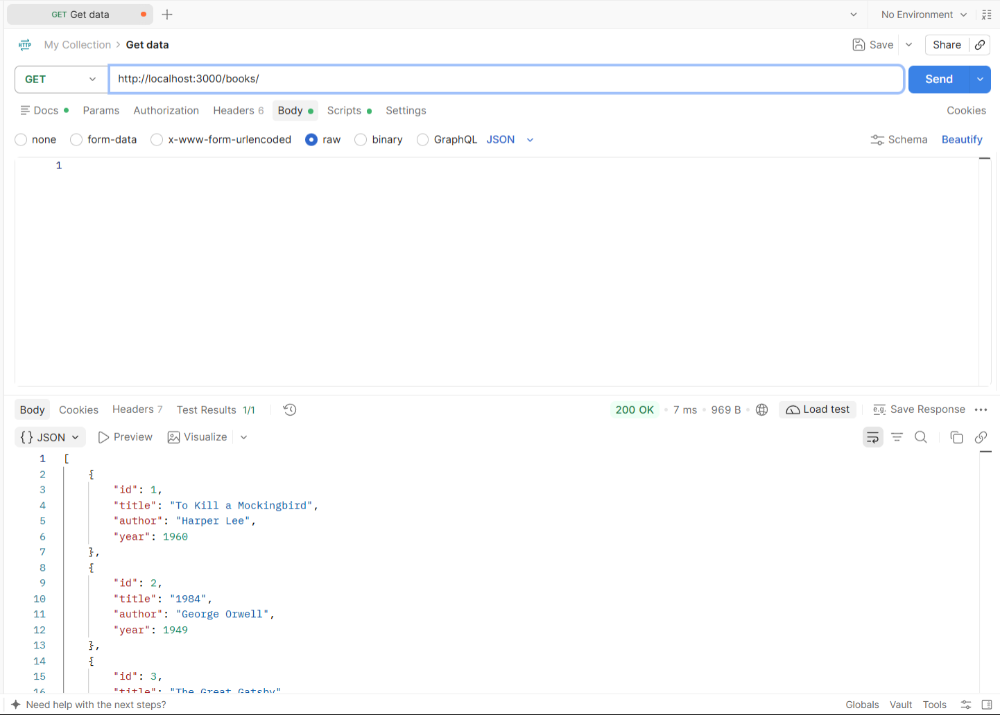
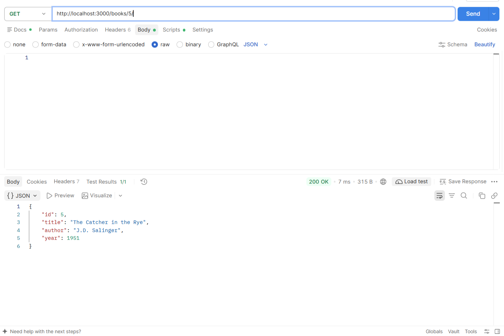
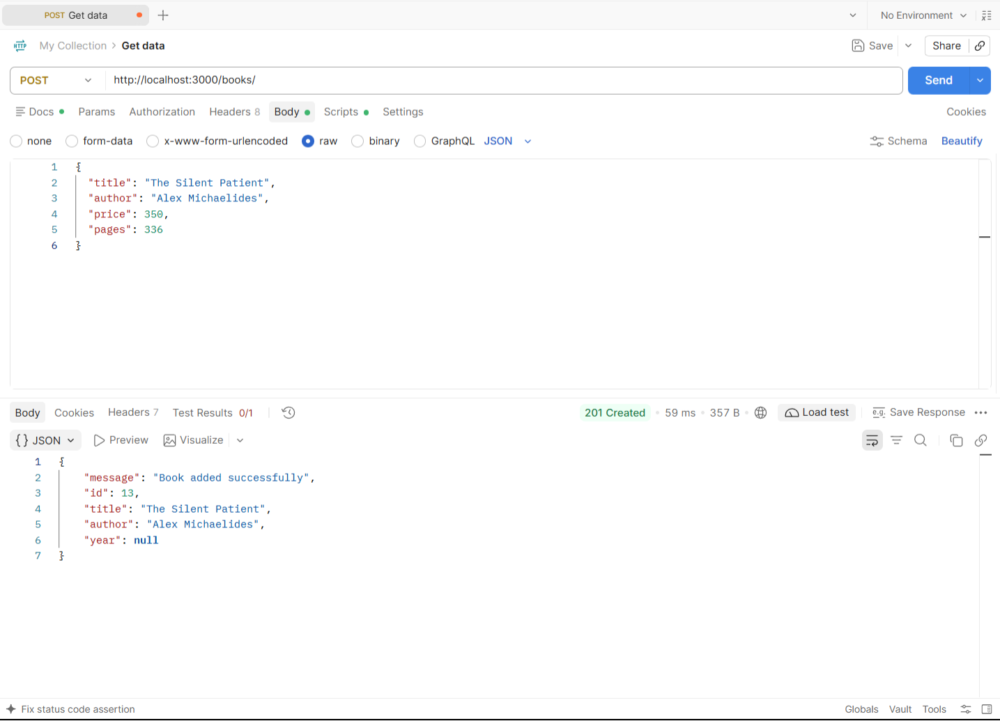
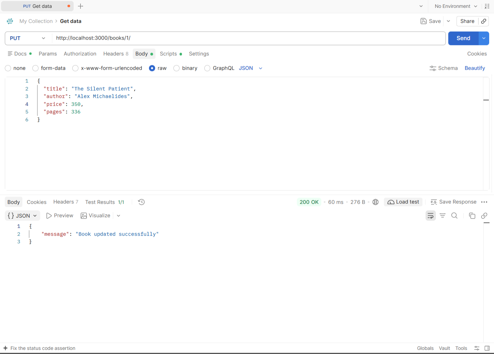
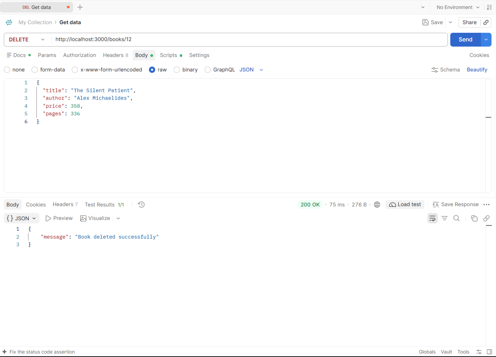

# BDF Lab 02 - SQLite Database and CRUD Routes

A comprehensive backend development lab demonstrating how to connect an **Express.js** web server to an **SQLite** database and implement full **CRUD** (Create, Read, Update, Delete) RESTful API endpoints with parameterized queries, error handling, and cloud deployment configuration.

---

## 👤 Author Information

- **Name:** G. Meghana
- **Section:** CSE GEN-AI-2A

---

## 📁 Project Structure

```text
lab-02/
├── screenshots/          # Verification screenshots for CRUD operations
│   ├── get_all_books.png
│   ├── get_one_book.png
│   ├── post.png
│   ├── put.png
│   └── Delete_book.png
├── .gitignore            # Git ignore file (node_modules, sqlite3.exe)
├── books.db              # SQLite database storing book records
├── package.json          # Project metadata, dependencies, and build scripts
├── package-lock.json     # Dependency lockfile
├── server.js             # Express server with SQLite connection & CRUD routes
└── README.md             # Project documentation
```

---

## 🗄️ Database Schema

The SQLite database (`books.db`) contains a table named `books` defined as follows:

```sql
CREATE TABLE IF NOT EXISTS books (
  id INTEGER PRIMARY KEY AUTOINCREMENT,
  title TEXT NOT NULL,
  author TEXT NOT NULL,
  year INTEGER
);
```

| Column | Type | Constraints | Description |
| :--- | :--- | :--- | :--- |
| `id` | `INTEGER` | `PRIMARY KEY AUTOINCREMENT` | Auto-generated unique identifier |
| `title` | `TEXT` | `NOT NULL` | Title of the book |
| `author` | `TEXT` | `NOT NULL` | Author of the book |
| `year` | `INTEGER` | Optional | Publication year |

---

## 🚀 Getting Started

### Prerequisites

- [Node.js](https://nodejs.org/) (v18 or higher recommended)
- [npm](https://www.npmjs.com/) (bundled with Node.js)

Verify installations:
```bash
node -v
npm -v
```

### Installation

Clone the repository and install dependencies:

```bash
git clone https://github.com/meghanagogineni919-stack/Backend.git
cd Backend/lab-02
npm install
```

---

## 💻 Running the Application

### 1. Development Mode (with Nodemon auto-restart)
```bash
npm run dev
```

### 2. Production Mode
```bash
npm start
```

The server will initialize the SQLite database connection, verify the `books` table, and start listening on:
- **Local URL:** `http://localhost:3000`

---

## 📡 API Endpoints & CRUD Operations

All queries use parameterized SQL (`?` placeholders) to prevent SQL injection vulnerabilities.

| Method | Endpoint | Description | Status Code |
| :--- | :--- | :--- | :--- |
| `GET` | `/books` | Retrieve all books from the database | `200 OK` |
| `GET` | `/books/:id` | Retrieve a single book by its ID | `200 OK` / `404 Not Found` |
| `POST` | `/books` | Insert a new book record | `201 Created` / `400 Bad Request` |
| `PUT` | `/books/:id` | Update an existing book by its ID | `200 OK` / `404 Not Found` |
| `DELETE` | `/books/:id` | Delete a book record by its ID | `200 OK` / `404 Not Found` |

---

### Request & Response Examples

#### 1. Retrieve All Books
- **Request:** `GET http://localhost:3000/books`
- **Response:** `200 OK`
```json
[
  {
    "id": 1,
    "title": "To Kill a Mockingbird",
    "author": "Harper Lee",
    "year": 1960
  },
  {
    "id": 2,
    "title": "1984",
    "author": "George Orwell",
    "year": 1949
  }
]
```

#### 2. Retrieve a Book by ID
- **Request:** `GET http://localhost:3000/books/1`
- **Response:** `200 OK`
```json
{
  "id": 1,
  "title": "To Kill a Mockingbird",
  "author": "Harper Lee",
  "year": 1960
}
```

#### 3. Add a New Book
- **Request:** `POST http://localhost:3000/books`
- **Headers:** `Content-Type: application/json`
- **Body:**
```json
{
  "title": "The Great Gatsby",
  "author": "F. Scott Fitzgerald",
  "year": 1925
}
```
- **Response:** `201 Created`
```json
{
  "message": "Book added successfully",
  "id": 3,
  "title": "The Great Gatsby",
  "author": "F. Scott Fitzgerald",
  "year": 1925
}
```

#### 4. Update an Existing Book
- **Request:** `PUT http://localhost:3000/books/1`
- **Headers:** `Content-Type: application/json`
- **Body:**
```json
{
  "title": "To Kill a Mockingbird (Special Edition)",
  "author": "Harper Lee",
  "year": 1960
}
```
- **Response:** `200 OK`
```json
{
  "message": "Book updated successfully"
}
```

#### 5. Delete a Book
- **Request:** `DELETE http://localhost:3000/books/1`
- **Response:** `200 OK`
```json
{
  "message": "Book deleted successfully"
}
```

---

## 📸 Output & Verification Screenshots

| Operation | Output Screenshot |
| :--- | :---: |
| **GET All Books** |  |
| **GET One Book** |  |
| **POST Add Book** |  |
| **PUT Update Book** |  |
| **DELETE Book** |  |

---

## ☁️ Deployment Configuration (Render)

This project is configured for seamless deployment on [Render](https://render.com/). To ensure native SQLite binary compatibility with Render's Linux runtime environment, the project builds SQLite from source:

| Render Setting | Configuration Value |
| :--- | :--- |
| **Runtime** | `Node` |
| **Root Directory** | `lab-02` |
| **Build Command** | `npm install && npm run build` |
| **Start Command** | `npm start` |

---

## 🛠️ Built With

- [Node.js](https://nodejs.org/) - JavaScript runtime environment
- [Express.js](https://expressjs.com/) - Web framework for Node.js
- [SQLite3](https://github.com/TryGhost/node-sqlite3) - Asynchronous SQLite3 driver
- [sqlite](https://github.com/kriasoft/node-sqlite) - Promise-based SQLite client library
- [Nodemon](https://nodemon.io/) - Development monitoring utility
